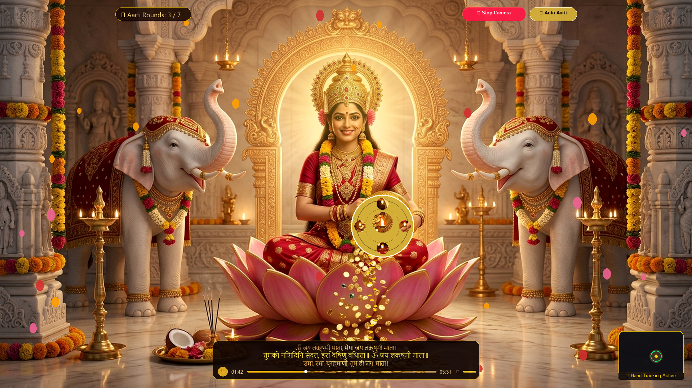
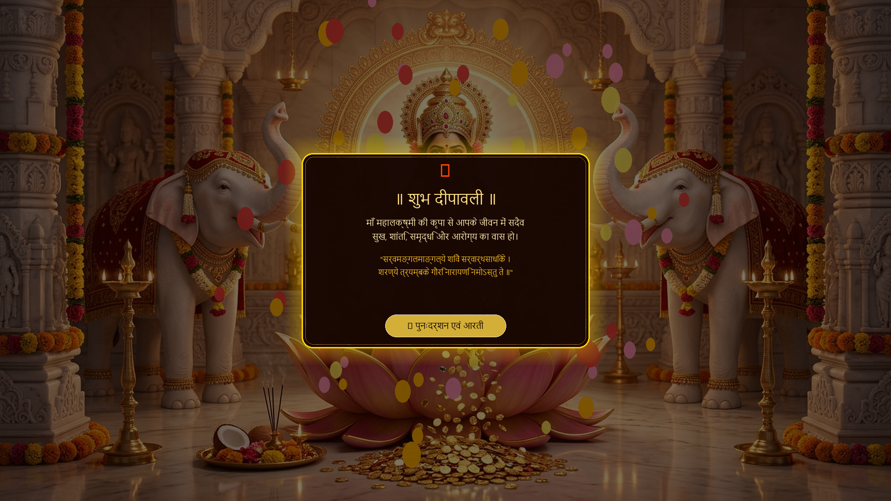
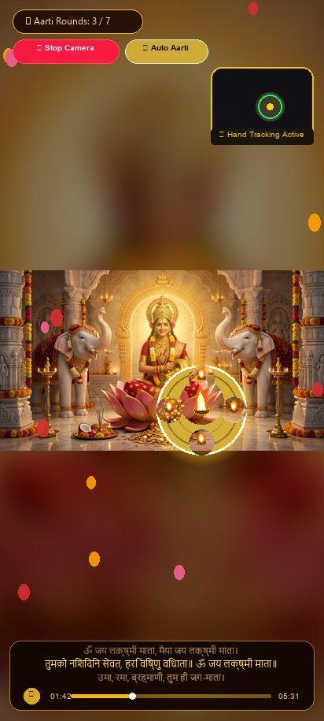
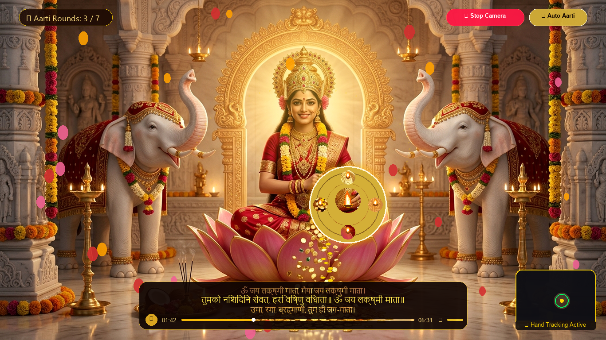

# 🪔 Shree Lakshmi Dham (श्री लक्ष्मी धाम)
### Virtual Maa Lakshmi Darshan, Aarti & Divine Blessings

[](LICENSE)
[]()
[]()
[]()

**Shree Lakshmi Dham** is an immersive, cinematic, devotional virtual sanctuary for Maa Maha Lakshmi Darshan, interactive Aarti, and divine blessings. Engineered with vanilla web standards, high-resolution 4K devotional art, hardware-accelerated 60 FPS canvas physics, dual-engine gesture tracking, and procedural temple acoustics.

---

## 📸 Visuals & Screenshots

| Desktop 1080p Aarti & Synchronized Lyrics | Final Divine Blessings |
|:---:|:---:|
|  |  |

| Mobile Portrait Darshan & Thali | Dedicated Hardware Diagnostic HUD |
|:---:|:---:|
|  |  |

---

## 🌟 Key Features

### 1. Cinematic Opening & Darshan Reveal
- **Holy Feet Welcome Experience**: Fullscreen 1080p ambient video of Maa's lotus feet, living diya flame, rotating golden chakra, and ambient temple bells.
- **Scroll-Triggered Silk Curtains**: GSAP-driven parting of rich red silk temple curtains with golden embroidered borders.
- **Sacred Shankh Naad & Voiceover**: Authentic conch shell resonance and natural Hindi voice greeting (*"आइए, माँ की आरती आरंभ करें।"*).
- **Edge-to-Edge 4K Sanctum Darshan**: Divine master artwork of Maa Maha Lakshmi seated on a pink lotus, flanked by sacred white elephants and overflowing golden kalash.

### 2. Living Temple Environment (60 FPS Canvas Physics)
- **Multi-Depth Petal Showers**: Procedural flower petals with dynamic 3D tumbling, wobble, and depth layering.
- **Continuous Gold Coin Cascades**: Shimmering Lakshmi coins dropping and gathering in the sanctum.
- **Organic Diya Flames & Incense Smoke**: Multi-harmonic sinusoidal flame flickering with soft upward-drifting temple dhoop smoke.

### 3. Mandir Pedestal & Synchronized Aarti Lyrics
- **Authoritative Soundtrack**: Full 05:31 master recording of *"ॐ जय लक्ष्मी माता"*.
- **Synchronized Devanagari Lyrics**: Real-time karaoke-style 3-line floating display, precision-synchronized across all 25 vocal and instrumental segments.
- **Custom Mandir Player**: Golden seek bar, volume control, time display, play/pause, and seamless replay controls.

### 4. Interactive Aarti Thali & Hand Gesture Tracking
- **Ornate Brass Aarti Thali**: Camphor jyoti and four ghee wicks featuring realistic aerodynamic flame tilt and spring-damper lerp motion.
- **Dual-Engine Hand Tracking**:
  - **Primary**: Deep-learning MediaPipe Hands (21 3D landmarks, tracking palm center).
  - **Fallback**: Zero-dependency local canvas skin-chroma centroid tracking.
  - **Zero Server Uploads**: 100% on-device optical processing for total privacy.
- **Mouse & Touch Fallback**: Fluid tracking across desktops, tablets, and smartphones.
- **Sacred Clockwise Parikrama Engine**:
  - Strict circular parikrama tracking with central deadzone filtering.
  - Graceful unwinding on counter-clockwise movement (anticlockwise rejection).
  - Resonant temple bell chimes synthesized on every quarter turn ($960\text{ Hz} - 1180\text{ Hz}$) via the Web Audio API.
  - Celebratory flower shower bursts upon completing full circular rounds.

### 5. Final Divine Blessings Sequence
- **7-Round Completion**: Automatic transition into the blessings ceremony.
- **Optical Hardware Shutdown**: Instantly halts all webcam media streams and shuts off the camera hardware LED.
- **Shankh Naad & Spoken Blessing**: Celebratory conch call, flower burst, and spoken Hindi blessing prayer.
- **Radiant Blessing Card**: Glowing festive card with traditional Sanskrit shloka (*"सर्वमङ्गलमाङ्गल्ये..."*) and replay option.

---

## 🛠️ Technology Stack

- **Markup & Styling**: Semantic HTML5, CSS3 Modern Flexbox/Grid, Custom Properties, Golden Typography (`Cinzel`, `Rozha One`, `Noto Serif Devanagari`).
- **Animation & Motion**: GSAP (GreenSock Animation Platform) for curtain timelines; HTML5 2D Canvas for continuous 60 FPS environmental physics.
- **Computer Vision**: Google MediaPipe Hands (`@mediapipe/hands`), Canvas 2D Skin-Chroma Computer Vision Fallback.
- **Audio & Acoustics**: Web Audio API (procedurally synthesized bell chimes), HTML5 Audio API (soundtrack & conch naad), Web Speech API (Hindi speech synthesis).
- **Architecture**: Zero-dependency, zero-build client application. Runs directly in any modern web browser.

---

## 🚀 Local Setup & Installation

### Prerequisites
- Modern web browser (Google Chrome, Microsoft Edge, Firefox, or Safari).
- Python 3.x (to run a lightweight local HTTP server for webcam secure context).

### Step 1: Clone the Repository
```bash
git clone https://github.com/pranjalisantani/shree-lakshmi-dham.git
cd shree-lakshmi-dham
```

### Step 2: Start Local Server
Web browsers restrict camera access (`getUserMedia`) to **Secure Contexts** (`https://` or `http://localhost`). Launch a local server:

```bash
# Using Python
python -m http.server 8000
```

### Step 3: Open in Browser
Open your browser and navigate to:
```
http://localhost:8000/index.html
```

To run the dedicated optical camera test harness with diagnostic telemetry:
```
http://localhost:8000/manual_hardware_test.html
```

---

## 📁 Repository Structure

```
shree-lakshmi-dham/
├── index.html                   # Main entry point (Welcome -> Curtains -> Darshan -> Aarti)
├── preview_darshan.html         # Direct Sanctum & Aarti preview
├── manual_hardware_test.html    # Dedicated hardware testing harness with telemetry HUD
├── css/
│   ├── welcome.css              # Opening video & holy feet styling
│   ├── curtains.css             # Royal silk curtain animations & golden trims
│   ├── sanctum.css              # 4K Darshan layout & visual effects
│   ├── aarti_player.css         # Mandir audio player & synchronized lyrics pedestal
│   └── aarti.css                # Floating Aarti thali, wicks, flames & PiP camera box
├── js/
│   ├── welcome.js               # Scroll, swipe, and key navigation trigger
│   ├── curtains.js              # GSAP curtain opening timeline & voiceover coordinator
│   ├── environment.js           # 60 FPS canvas engine (petals, coins, diya flames, smoke)
│   ├── aarti_player.js          # Synchronized lyrics manager & HTML5 audio controller
│   └── aarti.js                 # MediaPipe hand tracking, parikrama math & blessings
├── data/
│   └── aarti_lyrics.json        # Authoritative Devanagari lyrics with millisecond timestamps
├── media/
│   └── audio/
│       └── maa-lakshmi-aarti.mp3# Complete 05:31 master soundtrack
├── maa_lakshmi_darshan_4k.jpg   # Master 4K devotional artwork
└── cinematic_diwali_darshan_1080p.mp4 # Opening holy feet welcome video
```

---

## 🔒 Privacy & Security

- **Zero Data Transmission**: All webcam video feeds are processed entirely client-side inside the local browser memory.
- **Automatic Hardware Stop**: Camera streams are explicitly released and stopped when Aarti completes or when the camera is toggled off.
- **Graceful Fallback**: If camera access is denied, full mouse and touch interactions remain 100% functional.

---

## 📜 License

This project is licensed under the MIT License — see the [LICENSE](LICENSE) file for details.

